<div align="center">

# ClaimSaathi

**A family-side AI agent that tracks a health insurance claim, finds the right missing document, and uploads it only after a person approves.**

*"Where is my father's claim?" → the real status, a checked list of missing documents, and one clear next step.*


Ziro Agentic AI Hackathon 2026 · Healthcare track · **Insurance Claim Status Tracker** · Team **Twinkle Stars**

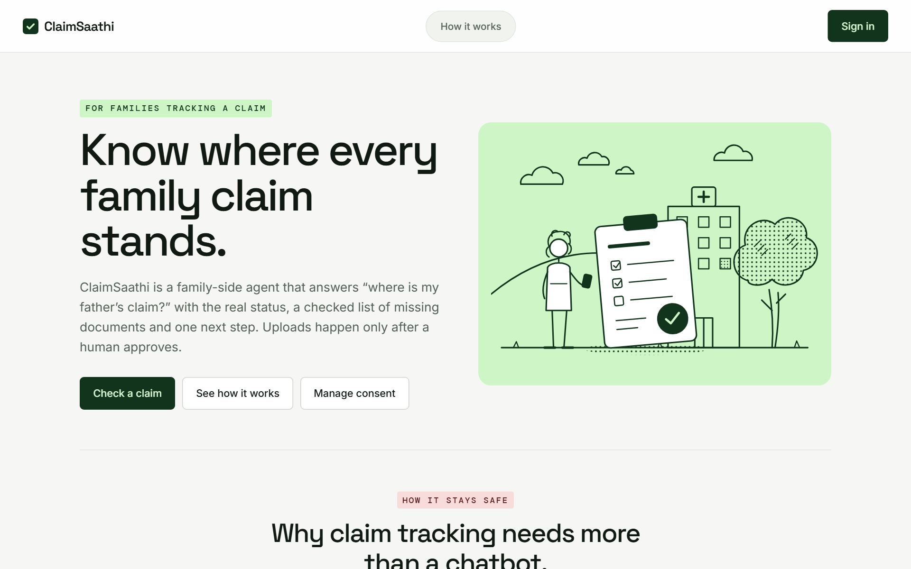

</div>

> [!IMPORTANT]
> **Synthetic demo.** Every person, policy, claim, hospital and document in this repository is invented. The TPA
> portal is a mock we built for the demo, not a real insurer system. No real health or insurance data is used anywhere.

---

## Contents

1. [The problem](#1-the-problem)
2. [The solution](#2-the-solution)
3. [Official test cases at a glance](#3-official-test-cases-at-a-glance)
4. [System overview](#4-system-overview)
5. [The user journey](#5-the-user-journey)
6. [How it works](#6-how-it-works)
   [Workflow](#61-the-langgraph-workflow) ·
   [Consent](#62-consent-gate) ·
   [Status](#63-status-you-can-trust) ·
   [Matching](#64-document-matching) ·
   [Upload](#65-approval-upload-and-verification) ·
   [Timeouts](#66-tc4-when-the-upload-times-out) ·
   [Evidence](#67-evidence-and-audit-trail)
7. [Screenshots](#7-screenshots)
8. [Getting started](#8-getting-started)
9. [Demo in five minutes](#9-demo-in-five-minutes)
10. [The mock TPA portal](#10-the-mock-tpa-portal)
11. [Project structure and tech stack](#11-project-structure-and-tech-stack)
12. [Reference: configuration, API, CLI, database](#12-reference)
13. [Testing](#13-testing)
14. [Safety principles](#14-safety-principles)
15. [Limitations and roadmap](#15-limitations-and-roadmap)
16. [Troubleshooting](#16-troubleshooting)
17. [Diagrams](#17-editing-the-diagrams)
18. [Team](#18-team)

---

## 1. The problem

When someone in the family is in hospital, a son or daughter usually ends up chasing the insurance claim. They log
in to the **TPA portal** (the claims website run for the insurer) and face:

| What they see | What goes wrong |
| --- | --- |
| *"Query Raised"*, *"Under Process - Pending Final Authorisation"* | Jargon nobody explains. People don't know if they need to act. |
| *"Pre-authorisation APPROVED Rs 50,000"* | Read as "the claim is approved". It is only the estimate given at admission. |
| A list of missing documents | They upload their mother's bill to their father's claim, or an invoice from the wrong dates. |
| Requests for indoor case papers or the final bill | They chase records the **hospital** is supposed to send to the TPA. |
| An upload that hangs | They upload again and create duplicates, or assume it worked when it didn't. |
| A parent's claim | Relatives look at private medical details without the patient's say. |

<details>
<summary><b>New to Indian health insurance? A 30-second glossary</b></summary>

| Term | Meaning |
| --- | --- |
| **Policy** | The insurance contract. A *family floater* covers the whole family under one shared sum. |
| **Claim** | A request to the insurer to pay for one hospital stay. Each stay gets its own claim number. |
| **Cashless** | The insurer pays the hospital directly. The hospital's insurance desk sends its records to the TPA. |
| **Reimbursement** | The family pays first, then claims the money back with the bills. |
| **TPA** | Third Party Administrator: the company that processes claims for the insurer and runs the portal. |
| **Pre-authorisation** | At admission, the insurer approves an *estimated* amount. The final decision comes after discharge. |
| **Query raised** | The reviewer needs more documents before deciding. |
| **Patient** | The insured person who was treated. Their consent is needed before anyone else sees their claim. |

</details>

## 2. The solution

ClaimSaathi is an **assistant for the family**. It does not replace the TPA and it does not talk to the hospital's
systems. It logs in to the TPA portal **with the family's own login, the way a person would**, and does the legwork:

| Step | ClaimSaathi does | A person does |
| --- | --- | --- |
| 1 | Checks the patient has consented | The patient grants or revokes consent |
| 2 | Opens the portal in its own browser and logs in | **Types the OTP**. The agent never reads or fills it. |
| 3 | Reads the status, pre-authorisation and requested documents, saving a screenshot of each page | |
| 4 | Turns the raw status into plain language with a **fixed rule table** | |
| 5 | Finds the right file: patient, type, dates, readability, not already sent | |
| 6 | Shows an approval card with preview and SHA-256 fingerprint | **Approves or rejects** the exact file |
| 7 | Uploads once, then **re-reads the portal** to prove it landed | Presses *Retry* if a re-read shows it missing |
| 8 | Replies with the status, each document's state and **one next step** | |

**The design rule:** an AI model never makes a decision. Consent, status, document eligibility and upload state are
all deterministic, tested rules. A model (Gemini, optional) may only help read the page and phrase the reply, and both
outputs are checked before use. With no API key at all, everything still works.

## 3. Official test cases at a glance

| Case | Situation | ClaimSaathi's behaviour | Result |
| --- | --- | --- | --- |
| **TC1** | A pharmacy invoice is missing on the father's claim | Finds `pharmacy_invoice_ramesh.pdf`, waits for approval, uploads once, re-reads the portal: **VERIFIED** | PASS |
| **TC2** | The son asks about his mother's claim without her consent | Stops with `NEEDS_CONSENT` **before the portal is opened**, sends the mother a consent request | PASS |
| **TC3** | The portal shows pre-auth APPROVED Rs 50,000, claim pending final authorisation | Reports **UNDER_REVIEW**, shows the pre-auth separately, the reply guard blocks "approved" | PASS |
| **TC4** | The portal stores the upload but times out | Records **UNKNOWN**, re-reads the document list, finds the file: **VERIFIED**, no second upload | PASS |

Six edge cases also pass: **E1** wrong-patient invoice, **E2** consent revoked, **E3** unknown status text, **E4**
wrong OTP, **E5** portal outage, **E6** hospital-held documents. Inputs, expected and actual results, every check and
evidence links are in [docs/test-evidence.md](docs/test-evidence.md).

## 4. System overview

<p align="center">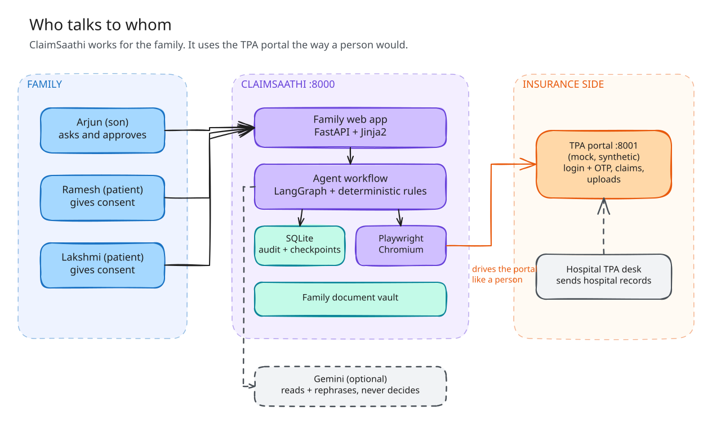</p>

There are two separate web apps, and they talk **only through a browser**, exactly as a person would:

| App | Port | Role |
| --- | --- | --- |
| **ClaimSaathi agent** (`agent/`, `web/`) | 8000 | The product: family web app, LangGraph workflow, Playwright portal adapter, SQLite audit store |
| **Mock TPA portal** (`portal/`) | 8001 | Stands in for an insurer's portal: login + OTP, claim pages, uploads, and a labelled demo admin page for faults |

**The demo family** (policy `POL-HDF-778812`, family floater):

| Person | Role | Consent given to Arjun |
| --- | --- | --- |
| **Arjun** (31) | Son, the user. Asks and approves. | n/a |
| **Ramesh** (62) | Father, patient. Admitted 14-18 Oct 2026, cashless. | `CLM-2026-0142`: read + upload. `CLM-2026-0163`: read only. |
| **Lakshmi** (58) | Mother, patient. Admitted 2-5 Oct 2026, reimbursement. | None (that's TC2) |

| Claim | Patient | Route | Portal says |
| --- | --- | --- | --- |
| `CLM-2026-0142` | Ramesh | Cashless | Query Raised: pharmacy invoice (`REQ-0142-01`) and indoor case papers (`REQ-0142-02`) |
| `CLM-2026-0150` | Lakshmi | Reimbursement | Under Review |
| `CLM-2026-0163` | Ramesh | Cashless | Under Process - Pending Final Authorisation; pre-auth **APPROVED** Rs 50,000 |

## 5. The user journey

<p align="center">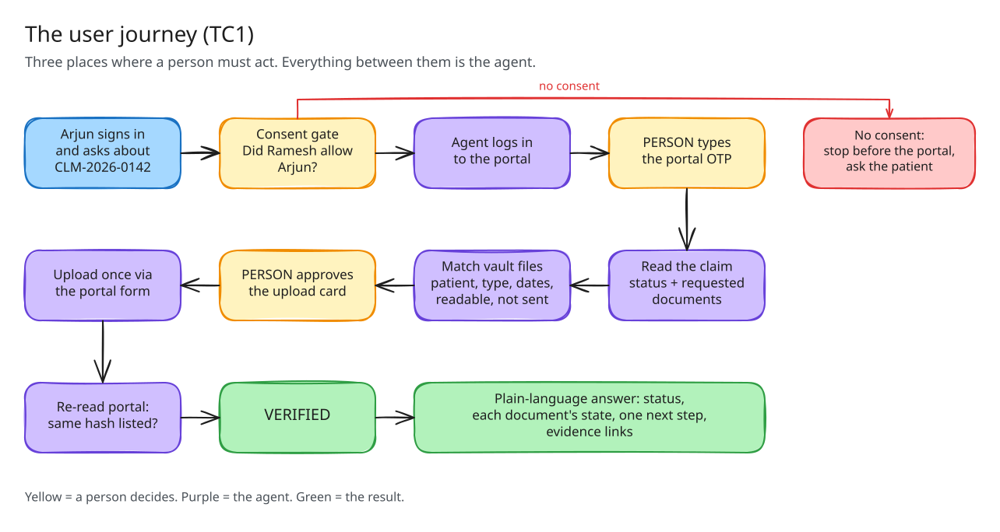</p>

A person acts at exactly three points: **consent**, **the OTP** and **the upload approval**. Everything in between is
the agent, and every step it takes is recorded.

## 6. How it works

### 6.1 The LangGraph workflow

<p align="center">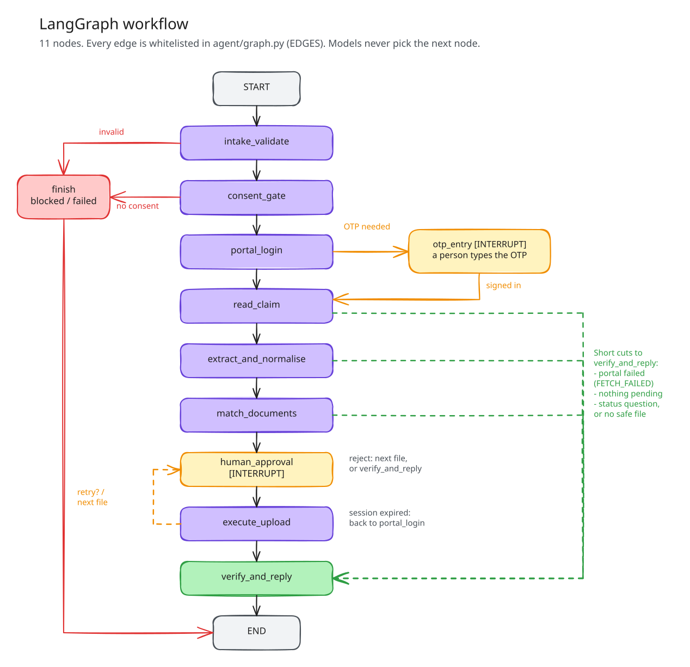</p>

[`agent/graph.py`](agent/graph.py) wires the services into one LangGraph state machine with **11 nodes**. Each node
returns its next node, and a whitelist (`EDGES`) refuses any move that is not allowed. Model output never chooses the
path.

- **Interrupts.** `otp_entry` waits for a person to type the OTP (3 tries per login, 3 logins).
  `human_approval` waits for *Approve*, *Reject* or, after a failed re-read, *Retry*.
- **Persistence.** The thread id is the run id. Checkpoints use LangGraph's `SqliteSaver` in the agent database, so a
  run resumes from its last completed node after a crash or restart (*Continue*).
- **Step log.** Every node execution is a row in `graph_steps`: input refs, decision, result, evidence ids, next
  node and error, including `INTERRUPTED` and `FAILED` rows. This drives the **Agent trace** tab.
- **Honest exits.** A status question never uploads. No consent means the portal is never opened. A failed portal
  read is `FETCH_FAILED`, never "no change". Session expiry anywhere routes back to `portal_login`.

<details>
<summary><b>Workflow state and exact branches</b></summary>

`ClaimState` holds: run id, requester, claim, policy, intent, consent results, portal session reference, raw claim
page, validated extraction, canonical status, requested and uploaded documents, vault candidates, matching results,
proposed action, approval decision, action and verification results, evidence ids, errors and the final response.

```text
intake_validate        -> consent_gate | finish
consent_gate           -> portal_login | finish
portal_login           -> otp_entry | read_claim | execute_upload | verify_and_reply | finish
otp_entry              -> otp_entry | portal_login | read_claim | execute_upload | verify_and_reply | finish
read_claim             -> extract_and_normalise | portal_login | verify_and_reply | finish
extract_and_normalise  -> match_documents | verify_and_reply
match_documents        -> human_approval | verify_and_reply
human_approval         -> human_approval | execute_upload | verify_and_reply
execute_upload         -> human_approval | portal_login | verify_and_reply
verify_and_reply       -> portal_login | END
finish                 -> END
```

</details>

### 6.2 Consent gate

<p align="center">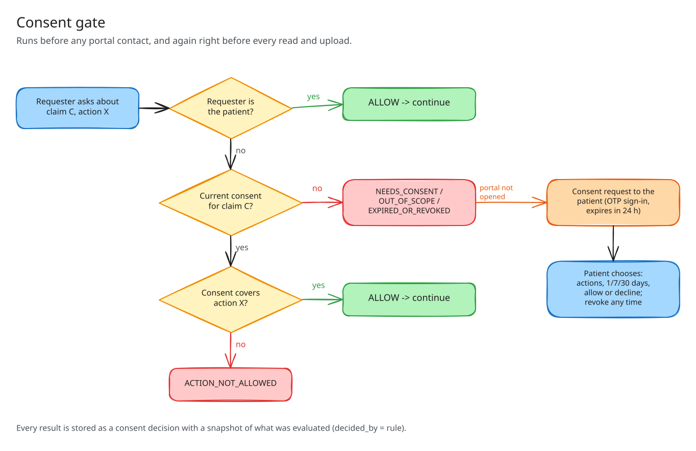</p>

Nothing about a claim is read unless its patient has consented, or the requester **is** the patient.

- **Trusted registry.** The `claims` table maps claim → patient → policy, so the gate never needs to open a protected
  page to learn whose claim it is.
- **Consent artefacts** name the patient, grantee, policy, one claim (or `*` only if the patient ticks "all my
  claims"), allowed actions (`read_status`, `upload_docs`), grant time, expiry and revoked flag.
- **`check_consent(requester, claim, action)`** returns `ALLOW`, `NEEDS_CONSENT`, `OUT_OF_SCOPE`,
  `ACTION_NOT_ALLOWED` or `EXPIRED_OR_REVOKED`, stored as a decision with a snapshot of what was evaluated.
- **Re-checked right before acting.** `guarded_portal_read`, `guarded_approve_upload` and `guarded_start_upload`
  check again, and a SQLite trigger refuses portal evidence in any run without an `ALLOW` decision.
- **Patient control.** Only the named patient's session can answer a request (it expires after 24 h). They can
  grant fewer actions, choose 1, 7 or 30 days, decline, and revoke any time on `/consent`.

### 6.3 Status you can trust

| Portal text | Canonical status | Why |
| --- | --- | --- |
| `Query Raised` | `QUERY_RAISED` | Phrase table match |
| `Under Process - Pending Final Authorisation` | `UNDER_REVIEW` | Matches `pending final` and `under process`; **pre-auth is ignored** (TC3) |
| `Escalated to medical panel` | `UNCERTAIN` | Not in the table, so the agent says it can't confirm (E3) |

- **Extraction** ([`agent/extract.py`](agent/extract.py)) fills one strict Pydantic schema from the page's stable
  selectors. With `GEMINI_API_KEY`, Gemini reads the visible text under a JSON schema. That output is **rejected** if
  it is malformed, names the wrong claim or policy, contains a value not on the page, or disagrees with the DOM.
- **Normalisation** ([`agent/status.py`](agent/status.py)) uses an ordered phrase table with word boundaries,
  longest match, negation handling ("not approved", "yet to be approved") and conflict detection. It takes **only**
  the raw claim status, so pre-authorisation cannot leak in. Canonical values: `QUERY_RAISED`, `UNDER_REVIEW`,
  `PARTIALLY_APPROVED`, `APPROVED`, `SETTLED`, `REJECTED`, `CLOSED`, `UNCERTAIN`.
- **Replies** ([`agent/reply.py`](agent/reply.py)) are a deterministic template. An optional model rephrase must pass
  a guard: no "approved / sanctioned / settled / paid" unless the status allows it, no new numbers, claim id kept.
  Otherwise the template is used.

### 6.4 Document matching

<p align="center">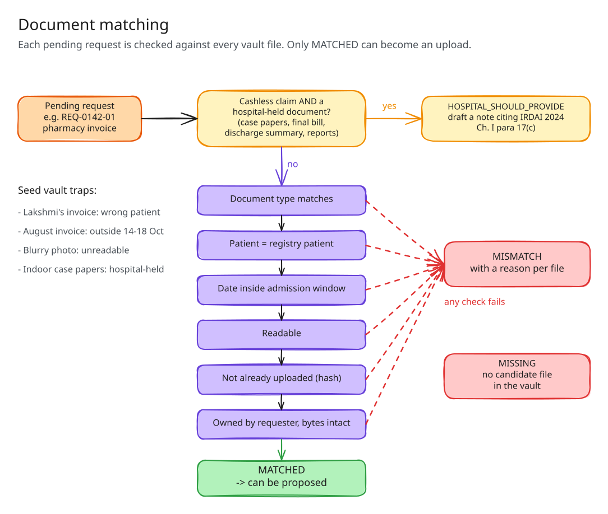</p>

[`agent/matcher.py`](agent/matcher.py) returns `MATCHED`, `MISMATCH`, `MISSING` or `HOSPITAL_SHOULD_PROVIDE` for each
pending request, with a reason per file.

- **Checks:** document type, the registry's patient, the admission window (widened only by configured pre/post days),
  readability, already-uploaded hash, ownership and vault integrity.
- **Hospital-held rule:** on cashless claims, indoor case papers, the final hospital bill, the discharge summary and
  investigation reports are the hospital's to send (IRDAI Master Circular on Health Insurance Business, 29 May 2024,
  Ch. I para 17(c)). The agent drafts a note to the hospital's TPA desk, labelled as practical guidance, not legal
  advice, and never uploads these from the family vault.
- **Only `MATCHED` can become an upload.** `propose_upload` enforces this, and so does a SQLite trigger.

### 6.5 Approval, upload and verification

<p align="center">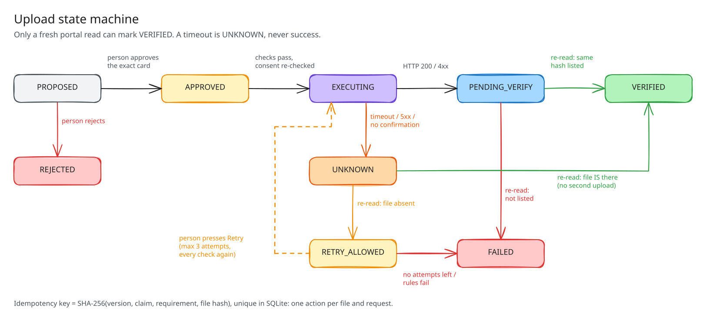</p>

[`agent/actions.py`](agent/actions.py) owns every upload.

- **Approval card.** Patient, claim, requirement, file name, preview, SHA-256, the match decision and the portal read
  it rests on, destination and every check. *Approve* posts the card's own SHA-256, so the person approves exactly
  what they saw. A changed card is refused (`card_changed`).
- **Idempotency.** The key is SHA-256 over a length-prefixed encoding of a version tag, claim id, requirement id and
  file hash. It is unique in SQLite, as is (claim, requirement, file). Proposing, approving or executing again returns
  the same action. Triggers refuse re-pointing an action, reopening it, or executing without a matching approval.
- **Before every attempt:** consent, approval binding, file bytes, patient, type, date window, legibility, the
  requirement on a fresh page read, and hashes already on the claim. The move to `EXECUTING` and the attempt row are
  one transaction, and only one open attempt per action is allowed, so concurrent clicks upload at most once.
- **After every attempt:** a fresh read of the document list. `VERIFIED` only when the same hash is listed under the
  same requirement. HTTP 200 or 4xx means `PENDING_VERIFY`. A timeout, 5xx or anything unconfirmed means `UNKNOWN`.
- **Retries are never automatic.** A person presses *Retry upload* (max 3 attempts), and every check runs again. An
  attempt that never reported back becomes `UNKNOWN` after its time bound plus 60 s, and is re-read, never re-sent.

### 6.6 TC4: when the upload times out

<p align="center">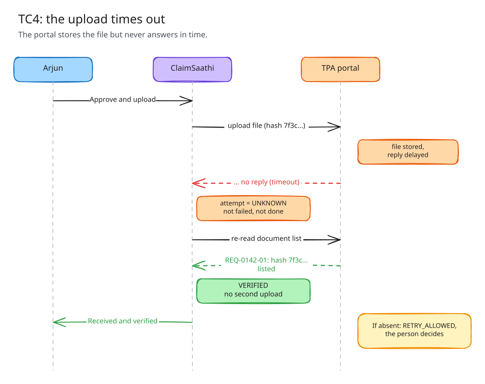</p>

The mock portal's `timeout_after_store` fault saves the file and then stalls. The client times out, so the attempt is
`UNKNOWN`. The re-read finds the same hash under `REQ-0142-01`, so the action goes `UNKNOWN → VERIFIED` with **one**
stored file and **no** second upload.

### 6.7 Evidence and audit trail

- **Every portal read and upload attempt**, including failures, saves a screenshot, the page HTML with its SHA-256,
  and the visible text under `evidence/<run_id>/`, with metadata in SQLite. Responses use evidence ids, never file
  paths.
- **Every decision** records `evidence_state`. `linked` means it points at evidence **from the same run** (enforced
  by a trigger). `missing` means evidence was needed but unavailable, and a status decision can then only be
  `UNCERTAIN`. `not_applicable` means it is a pure rule, such as a consent check.
- **`decided_by` is `rule` or `human`, never a model.** Model output is stored as evidence, not as a decision.
- **Logs** carry ids and kinds, never page content or file bytes.
- **The evidence page** (`/evidence/<id>`) re-checks the HTML hash and is visible only to the person whose run produced it.

## 7. Screenshots

| Claim result (TC1) | The "approved" trap (TC3) |
| --- | --- |
| 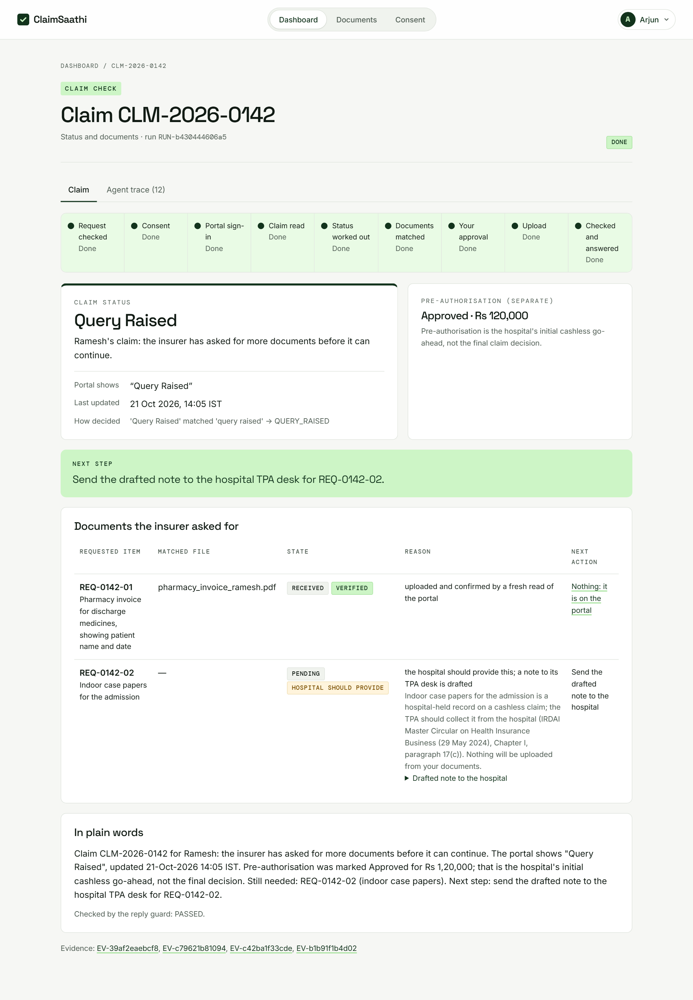 | 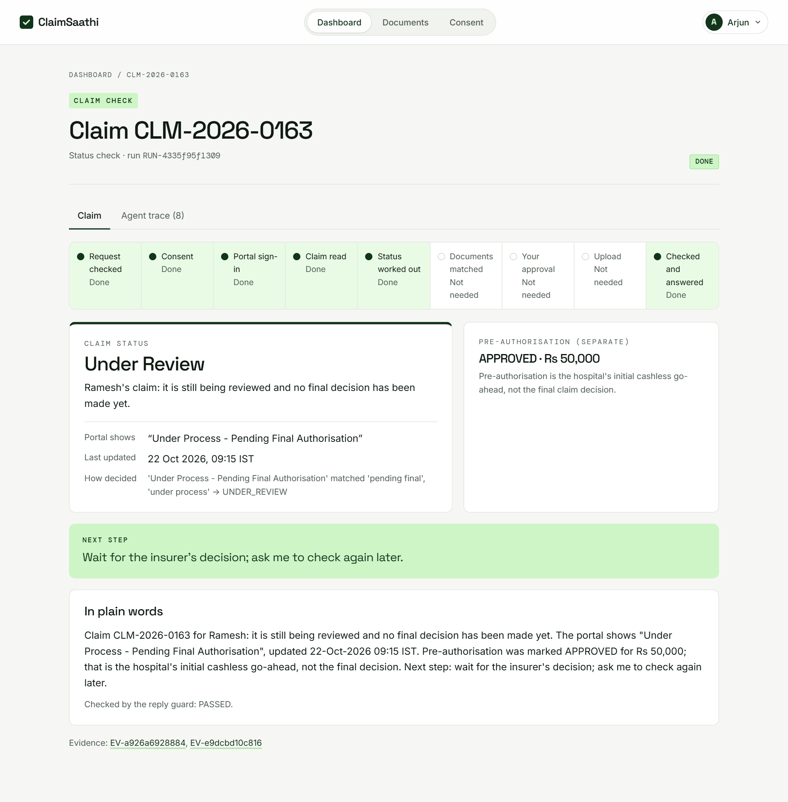 |
| **Agent trace** | **Consent needed (TC2)** |
| 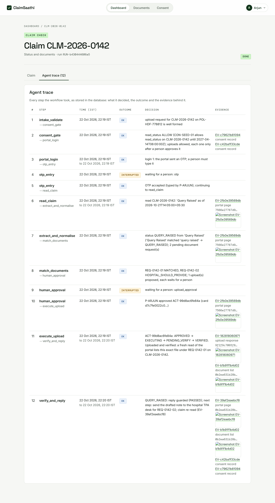 | 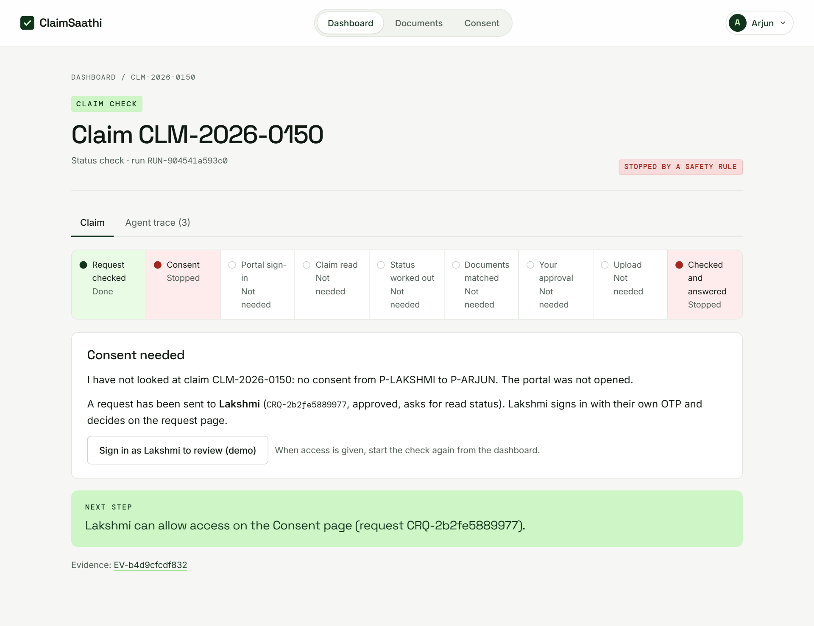 |
| **Dashboard** | **Test runs** |
| 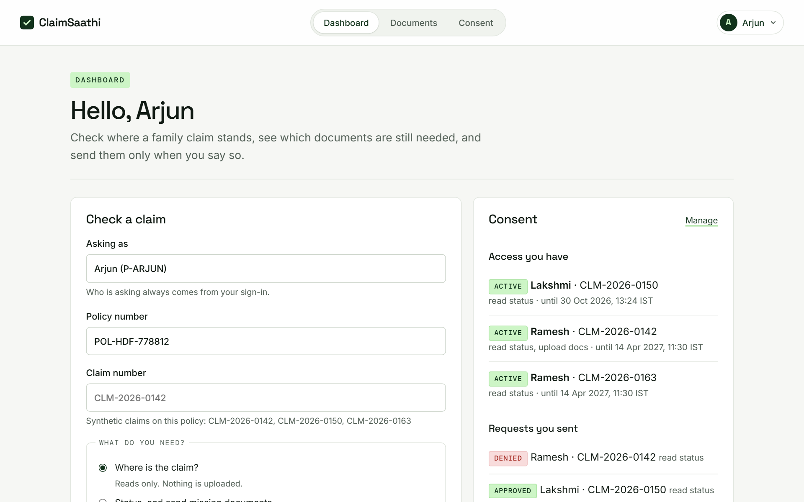 | 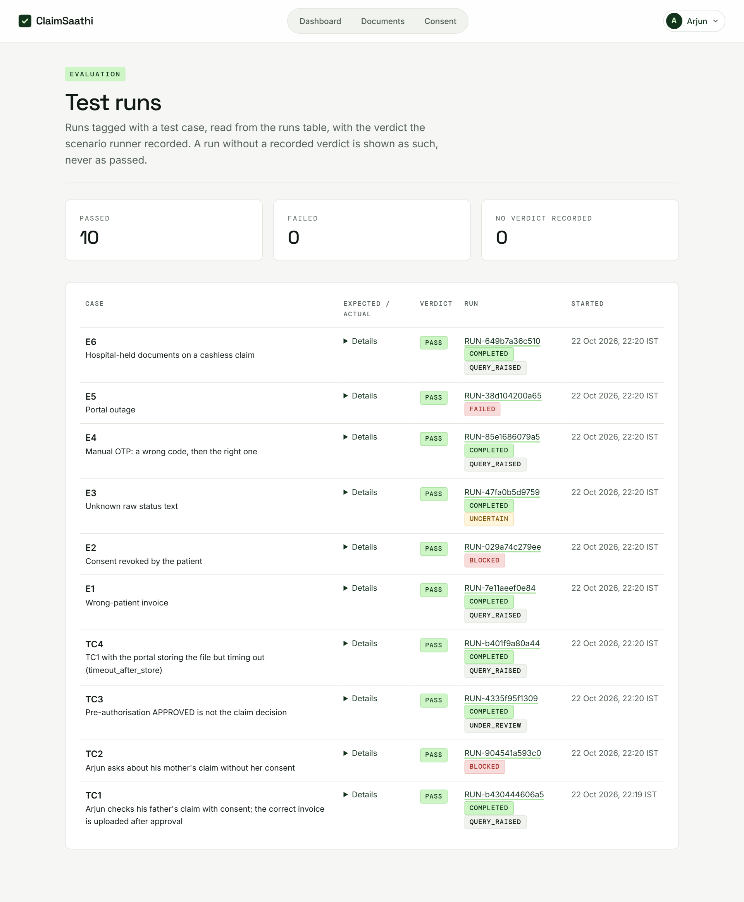 |

A guided, step-by-step tour of the whole flow is built into the app at **`/walkthrough`**.

## 8. Getting started

**Requirements:** Python 3.11+ (developed on 3.12), Windows PowerShell (the commands below; any OS works with the
equivalent shell), and disk space for Playwright's Chromium download.

```powershell
cd claimsaathi
python -m venv .venv
.\.venv\Scripts\Activate.ps1
python -m pip install --upgrade pip
pip install -r requirements.txt
python -m playwright install chromium
copy .env.example .env
```

The defaults in `.env` work as-is. No API key is required. See [configuration](#configuration) for every setting.

**Run** both apps, each in its own terminal with the venv active:

```powershell
.\scripts\run_portal.ps1   # mock TPA portal  -> http://127.0.0.1:8001
.\scripts\run_agent.ps1    # ClaimSaathi      -> http://127.0.0.1:8000
```

Or start them directly with `uvicorn portal.app:app --port 8001 --reload` and
`uvicorn agent.server:app --port 8000 --reload`. Check that `http://127.0.0.1:8000/health/ready` reports `"ready"`.
Run the portal with a single worker: its state lives in memory and resets on restart.

## 9. Demo in five minutes

| # | Do | You'll see |
| --- | --- | --- |
| 1 | Optional: `.\scripts\reset_demo.ps1` for clean data | |
| 2 | Open `http://127.0.0.1:8000/auth/login`, choose **Arjun**, type the OTP from the simulated SMS panel | Dashboard |
| 3 | Claim `CLM-2026-0142`, choose *Status, and send missing documents*, press **Check claim** | Consent passes, the agent logs in |
| 4 | Type the 6-digit code from the portal's OTP screen shown on the page | The agent reads the claim and matches files |
| 5 | Review the card and press **Approve and upload** | Upload **VERIFIED**, document table, one next step, **Agent trace** |
| 6 | **TC3:** check `CLM-2026-0163` | `UNDER_REVIEW` with pre-auth shown separately |
| 7 | **TC2:** check `CLM-2026-0150`, then sign in as **Lakshmi** → **Consent** → **Allow** | Blocked before the portal, then allowed by the patient |
| 8 | **TC4:** reset, set `timeout_after_store` on the portal's `/admin`, repeat steps 3-5 | `UNKNOWN`, then **VERIFIED** with one stored file |

| Login | Where | How |
| --- | --- | --- |
| Arjun (family), Ramesh and Lakshmi (patients) | agent `/auth/login` | Demo OTP shown on the page |
| `arjun` / `demo123` | portal `/login` (the agent uses it too) | OTP shown in the portal's simulated SMS panel |

> [!NOTE]
> An upload decision is permanent for its file and requirement (that is the idempotency guarantee), so run TC1 and TC4
> on a freshly reset database. `.\scripts\reset_demo.ps1` restores the agent seed and clears checkpoints, test results
> and `evidence/RUN-*` (`--keep-evidence` keeps the files). Use the portal's `/admin` **Reset all seeded data**, or
> restart it, to reset the portal.

A full presenter script with screen directions is in [docs/pitch-script.md](docs/pitch-script.md), and a plain-language
walkthrough is in [docs/walkthrough.md](docs/walkthrough.md).

## 10. The mock TPA portal

- **Login + manual OTP.** The OTP appears on a simulated SMS panel. No SMS is sent.
- **Uploads.** PDF, PNG or JPG against a request. The server checks the type by magic bytes, the size and the
  requirement, computes SHA-256, stores the file under a server-generated name, and refuses the same file twice for
  the same claim and request (HTTP 409).
- **Demo admin** (`/admin`, clearly labelled) resets data, changes a claim's raw status to any text, and sets the upload
  fault mode. Every attempt is listed in its upload log.

| Fault mode | Behaviour |
| --- | --- |
| `none` | Normal upload |
| `timeout_before_store` | Waits `PORTAL_FAULT_DELAY_SECONDS`, returns 504, file **not** stored |
| `timeout_after_store` | Stores the file, then stalls: the client times out after the server saved it (TC4) |
| `http_500` | Returns 500 immediately, file not stored |

*Apply to the next upload only* makes a fault one-shot. Otherwise it stays until changed.

<details>
<summary><b>Stable selectors used by the agent</b></summary>

`#claim-id`, `#claim-status` (`data-raw-status`), `#status-updated-at` (`datetime`), `#policy-number`,
`#patient-name`, `#claim-route`, `#admission-date`, `#discharge-date`, `#preauth-status`, `#preauth-amount`
(`data-amount`), `#requested-docs tr.requirement` (`data-req-id`, `data-state`, `data-doc-type`) and
`#uploaded-docs tr.uploaded-doc` (`data-sha256`, `.doc-filename`, `.doc-size[data-bytes]`, `.doc-uploaded-at time`).

Clients that send `Accept: text/html` get pages and redirects. Other clients get JSON, with errors as
`{"error": {"code", "message", "request_id", "details?"}}`.

</details>

**Porting to a real portal.** [`agent/portal_client.py`](agent/portal_client.py) separates a replaceable **driver**
(browser mechanics and selectors; `PlaywrightTpaDriver` for the mock) from a fixed **`PortalClient`** that owns the
safety rules. A real portal needs only a new `PortalDriver`. CAPTCHA and access controls are never bypassed, and failures
surface as typed errors: `PortalUnavailable`, `OtpRequired`, `OtpRejected`, `SessionExpired`, `CaptchaDetected`,
`LayoutChanged`, `ClaimNotFound`, `ClaimMismatch`, `NotApproved`, `UnsafeFile`.

## 11. Project structure and tech stack

```text
claimsaathi/
├── agent/            ClaimSaathi agent (FastAPI, port 8000)
│   ├── graph.py          LangGraph workflow, interrupts, checkpoints
│   ├── consent.py        consent gate and guarded actions
│   ├── portal_client.py  Playwright driver + safety-owning PortalClient
│   ├── extract.py        validated extraction (DOM or Gemini)
│   ├── status.py         deterministic status normalisation
│   ├── matcher.py        document matching and hospital-held rule
│   ├── actions.py        approval card, idempotent executor, verifier
│   ├── reply.py          templated reply + guard
│   ├── db.py, migrations.py, repository.py, seed.py, cli.py
│   └── *_routes.py       web pages and JSON API
├── portal/           mock TPA portal (FastAPI + Jinja2, port 8001)
├── shared/           logging, error envelope, web security, synthetic PDF/PNG makers
├── web/              agent templates and static files (incl. the /walkthrough tour)
├── tests/            pytest suite and scenario runner
├── scripts/          run, reset and smoke-test scripts
├── vault_samples/    synthetic family documents (seed/arjun/)
├── docs/             diagrams, screenshots, test evidence, walkthrough, pitch script
└── evidence/         per-run screenshots and HTML (git-ignored)
```

| Layer | Choice | Why |
| --- | --- | --- |
| Agent orchestration | **LangGraph** + `SqliteSaver` | Explicit state machine, human-in-the-loop interrupts, resumable checkpoints |
| Browser automation | **Playwright** (Chromium, local or Browserbase) | Uses the portal exactly as a person does; screenshots for evidence |
| Web apps | **FastAPI** + Jinja2 (server-rendered) | Small, fast, testable; no client-side state decides anything |
| Storage | **SQLite** via `sqlite3`, no ORM | Versioned schema, CHECK constraints and triggers enforce the safety rules |
| Validation | **Pydantic** | Strict schemas for extraction and every API body |
| Optional model | **Gemini** (`gemini-2.5-flash`) | Reads and rephrases only; always validated or guarded |
| Tests | **pytest** | 307 tests, including live-browser and end-to-end scenarios |

## 12. Reference

<details id="configuration">
<summary><b>Configuration (<code>.env</code>)</b></summary>

| Variable | Default | Notes |
| --- | --- | --- |
| `GEMINI_API_KEY` | empty | Optional. Without it, DOM extraction and template replies are used. |
| `GEMINI_MODEL` | `gemini-2.5-flash` | Used only when a key is set |
| `BROWSER` | `local` | `local` or `browserbase` |
| `BROWSERBASE_API_KEY` / `BROWSERBASE_PROJECT_ID` | empty | Only with `BROWSER=browserbase` |
| `PORTAL_BASE_URL` / `AGENT_BASE_URL` | `http://127.0.0.1:8001` / `:8000` | |
| `DATABASE_PATH` | `data/claimsaathi.db` | Created and migrated on startup |
| `VAULT_DIR` | `vault_samples` | Family documents; seed files in `seed/` |
| `EVIDENCE_DIR` | `evidence` | Per-run screenshots and HTML |
| `PORTAL_USERNAME` / `PORTAL_PASSWORD` | `arjun` / `demo123` | Synthetic portal account |
| `PORTAL_HEADLESS` | `true` | `false` shows the Chromium window |
| `PORTAL_TIMEOUT_MS` / `PORTAL_UPLOAD_TIMEOUT_MS` | `15000` / `10000` | Bounded waits |
| `POLICY_PRE_ADMISSION_DAYS` / `POLICY_POST_ADMISSION_DAYS` | empty | Set only if the policy states them |
| `AGENT_SESSION_SECRET` / `PORTAL_SESSION_SECRET` | random per run | Set long random values to keep sessions across restarts |
| `AGENT_HTTPS_ONLY_COOKIES` / `PORTAL_HTTPS_ONLY_COOKIES` | `false` | `true` behind HTTPS |
| `PORTAL_DATA_DIR` | `data/portal` | Portal upload storage |
| `PORTAL_MAX_UPLOAD_MB` | `5` | |
| `PORTAL_FAULT_DELAY_SECONDS` | `30` | Delay for the timeout fault modes |
| `LOG_LEVEL` | `INFO` | JSON logs with ids and kinds only |

`.env` is git-ignored. Never commit keys.

</details>

<details>
<summary><b>Web pages</b></summary>

| Agent (`:8000`) | Purpose |
| --- | --- |
| `/` · `/walkthrough` | Landing page · guided tour |
| `/auth/login` · `/auth/otp` | Choose a person · demo OTP |
| `/dashboard` · `/workflows` | Start a claim check, see consents and earlier checks |
| `/workflows/<run_id>` | Live claim view: stepper, OTP, approval card, status, documents, next step, **Agent trace** |
| `/vault` · `/vault/files/<id>` | The requester's documents |
| `/actions` · `/actions/<id>` | Proposed uploads · one approval card |
| `/consent` · `/consent/requests/<id>` | Consents given and received · answer a request |
| `/portal-session` | Manual portal sign-in |
| `/evidence/<id>` | Screenshot, hashed page source, recorded fields |
| `/test-runs` | TC1-TC4 and E1-E6 verdicts |
| `/health` · `/health/ready` · `/docs` | Liveness · readiness (database + portal) · OpenAPI |

| Portal (`:8001`) | Purpose |
| --- | --- |
| `/login` · `/otp` | Portal sign-in with simulated SMS OTP |
| `/claims` · `/claims/<id>` | Claim list · claim page with requested and uploaded documents |
| `/admin` | Demo controls: reset, change status, fault modes, upload log |

</details>

<details>
<summary><b>JSON API</b></summary>

Session cookie required. Every POST needs `x-csrf-token`. Ids are checked against strict formats (anything else is a
422), and request bodies reject unknown fields.

| Purpose | Endpoint |
| --- | --- |
| Create a run | `POST /api/workflows {"claim_id", "policy_no"?, "intent": "status" \| "upload"}` |
| Read run state | `GET /api/workflows/<run_id>` → `waiting_for_otp`, `waiting_for_approval`, `waiting_for_retry`, `running`, `completed`, `blocked`, `failed` |
| Supply the OTP | `POST /api/workflows/<run_id>/resume {"otp"}` |
| Approve / reject | `POST /api/workflows/<run_id>/resume {"decision", "card_sha256", "action_id"}` or `POST /api/actions/<id>/decision` |
| Recover a stopped run | `POST /api/workflows/<run_id>/continue` |
| Match documents | `POST /api/runs/<run_id>/match {"selections"?}` |
| Propose / execute / reconcile | `POST /api/runs/<run_id>/actions {"decision_id"}` · `POST /api/actions/<id>/execute` · `POST /api/actions/<id>/reconcile` |
| Consent | `POST /api/access-check` · `GET /api/consent-requests/<id>` · `POST .../approve {"actions"?, "duration_days"?, "all_claims"?}` · `POST .../deny` |
| Portal session | `POST /api/portal/session` · `POST /api/portal/session/otp` |
| Evidence | `GET /api/evidence/<id>` · `GET /evidence/<id>/screenshot` · `GET /evidence/<id>/html` |
| Test results | `GET /api/test-runs` |

There is **no endpoint that sets an action's state**. `VERIFIED` is only ever set by the server after a portal re-read.

</details>

<details>
<summary><b>CLI</b></summary>

```powershell
python -m agent.cli init-db           # create or migrate the schema, add missing seed rows (idempotent)
python -m agent.cli db-health         # version, foreign keys, integrity, row counts
python -m agent.cli reset-demo --yes  # delete every row and restore the synthetic seed
python -m agent.cli workflow --requester P-ARJUN --claim CLM-2026-0142 --intent upload   # interactive run
python -m agent.cli workflow --requester P-ARJUN --resume RUN-xxxxxxxxxxxx               # continue a saved run
```

</details>

<details>
<summary><b>Database schema (version 6)</b></summary>

SQLite through the standard library. Foreign keys are on for every connection, writes run in `BEGIN IMMEDIATE`
transactions, and timestamps are UTC (`2026-10-22T08:30:00Z`, and the schema rejects any other format). The version is
tracked by `PRAGMA user_version` and `schema_migrations`. New changes go in a new migration; applied ones are never
edited.

| Table | Purpose | Key rules |
| --- | --- | --- |
| `people` | Synthetic family members | `contact_ref` must start with `synthetic:` |
| `consents` | Scoped, revocable consent artefacts | Claim id or `*`; actions as JSON; no self-consent; expiry after grant |
| `runs` | One agent run | Final status from the canonical list; terminal states need `finished_at` |
| `evidence` | Every portal read or extraction | Append-only; HTML SHA-256; safe relative screenshot path |
| `vault_files` | Document metadata and safe path | Never file bytes; unique per owner and hash |
| `decisions` | Why each conclusion was reached | Append-only; `decided_by` is `rule` or `human` |
| `actions` | Upload state machine | Unique `idem_key` and (claim, requirement, file); never re-pointed or reopened |
| `action_approvals` | Approve / Reject | One per action; bound to claim, requirement and file; keeps the card shown |
| `action_checks` | Every eligibility check | Append-only; each rule, the portal read and consent decision used |
| `action_attempts` | Every upload attempt | One open attempt per action; outcome written once |
| `graph_steps` | Every workflow node execution | Append-only; inputs, decision, result, evidence, next node |

**Seed data** (fixed ids and timestamps, so every reset is identical): people `P-RAMESH`, `P-LAKSHMI` (patients) and
`P-ARJUN` (family). Consents: `CON-SEED-01` (Ramesh → Arjun, `CLM-2026-0142`, read + upload) and `CON-SEED-02`
(`CLM-2026-0163`, read only), valid until 2027-04-14. Nothing from Lakshmi. Vault: six files for Arjun, including the
correct invoice and deliberate traps (Lakshmi's invoice, an August invoice, a discharge summary, a blurry photo and
indoor case papers).

</details>

## 13. Testing

```powershell
pytest                 # everything except the scenarios
pytest -m "not live"   # skip tests that start real servers and headless Chromium
pytest -m scenario     # TC1-TC4 and E1-E6 end to end; rewrites docs/test-evidence.md
```

| Area | Covered |
| --- | --- |
| Data layer | Schema, migrations, CHECK constraints, foreign keys, rollback, append-only records, audit convention, seed and reset reproducibility |
| Portal | Login, manual OTP (lockout, never in the cookie), claim pages and selectors, uploads (validation, hashing, duplicates, path safety, CSRF), all four fault modes, a live `ReadTimeout` while the file is already stored |
| Consent | Grant, scope, expiry, revocation, patient-only approval, guarded actions |
| Actions | Rejection uploads nothing, approval uploads once, repeated approval is idempotent, revoked consent and wrong-patient files are blocked before sending, concurrent requests upload once |
| Workflow | Every branch, OTP interrupts (wrong, bounded, never bypassed), resume after restart, crash mid-upload, timeout recovery, web pages and CLI |
| Scenarios | TC1-TC4 and E1-E6 through the real workflow in headless Chromium, with evidence written to [docs/test-evidence.md](docs/test-evidence.md) and the **Test runs** page |

The scenario runner plays the family member: it reads the OTP from the portal's simulated SMS state, as a person reads
their phone, and approves or rejects the card. It is excluded from plain `pytest` because it resets the demo database.

## 14. Safety principles

- **Synthetic data only.** No real people, policies or medical records.
- **Consent before contact.** The patient's consent is checked before the portal is opened, and again before every read and upload.
- **A person types every OTP.** The agent never reads, stores or auto-fills it.
- **A person approves every upload,** of exactly the file shown, by hash.
- **No model decides.** Consent, status, matching and upload state are deterministic rules; model output is validated or guarded.
- **Proof before "done".** Only a fresh portal read showing the same hash marks an upload verified.
- **Uncertainty is shown as uncertainty.** `UNCERTAIN`, `UNKNOWN` and `FETCH_FAILED` are never reported as success or "no change".
- **No bypassing.** CAPTCHA and access controls are never circumvented.

## 15. Limitations and roadmap

**Current limitations**

- Local demo against a mock portal; no real insurer integration, and nothing is deployed.
- OTPs appear on simulated SMS panels; no SMS is sent.
- Vault documents are pre-loaded with their details labelled; there is no in-app upload or OCR yet.
- One portal browser session per agent process, shared by everyone signed in; locking assumes one agent process (the database still refuses duplicate uploads).
- An upload decision (rejected, failed, verified) is permanent for its file and requirement.
- Headless Chromium doesn't render PDF previews in the approval card; desktop browsers do.

**Next**

- Background status watcher that checks on a schedule and notifies the family when something changes.
- Document intake from phone, WhatsApp or email, with OCR or model extraction validated like the portal read.
- Per-person portal credentials, and drivers for real TPA portals.
- Chat-style view and regional-language replies (through the same reply guard).

## 16. Troubleshooting

| Problem | Fix |
| --- | --- |
| `Activate.ps1 cannot be loaded` | `Set-ExecutionPolicy -Scope CurrentUser RemoteSigned`, or call `.\.venv\Scripts\python.exe` directly |
| `[WinError 10048]` / address already in use | `Get-NetTCPConnection -LocalPort 8001` and stop the process, or change the port and `PORTAL_BASE_URL` |
| `/health/ready` says `degraded` | The portal isn't running, or `PORTAL_BASE_URL` is wrong |
| A new page returns 404 | The agent was started without `--reload`; restart it with `.\scripts\run_agent.ps1` |
| Logged out after a restart | Set `AGENT_SESSION_SECRET` / `PORTAL_SESSION_SECRET`; portal data also resets on restart by design |
| `ModuleNotFoundError: portal` / `agent` | Run commands from the `claimsaathi` folder |
| `Unversioned tables with data found` | Back up and delete the old database, then `python -m agent.cli init-db` |
| `database is locked` | Stop extra servers or CLI runs holding a write transaction |
| Upload rejected `file_content_mismatch` | The file's bytes don't match its extension (e.g. a PNG renamed `.pdf`) |

## 17. Editing the diagrams

Every diagram in this README was drawn with [Excalidraw](https://excalidraw.com). The editable sources sit next to
the exported images in [`docs/diagrams/`](docs/diagrams):

| Diagram | Source |
| --- | --- |
| System overview | `01-system-context.excalidraw` |
| User journey | `02-user-journey.excalidraw` |
| LangGraph workflow | `03-workflow-graph.excalidraw` |
| Consent gate | `04-consent-gate.excalidraw` |
| Document matching | `05-document-matching.excalidraw` |
| Upload state machine | `06-upload-state-machine.excalidraw` |
| TC4 timeout sequence | `07-tc4-timeout-sequence.excalidraw` |

To edit one, open [excalidraw.com](https://excalidraw.com) → *Open* → choose the `.excalidraw` file. Then *Export
image* → SVG with *Embed scene* and *Background* on, and replace the matching `.svg`.

## 18. Team

**Team Twinkle Stars**, Ziro Digital Agentic AI Hackathon 2026

- **Maheswar Sahoo**, team lead
- **Ravivarma Kompally**

<div align="center">
<sub>Built for families who shouldn't need to learn insurance jargon to get a parent's claim paid.</sub>
</div>
